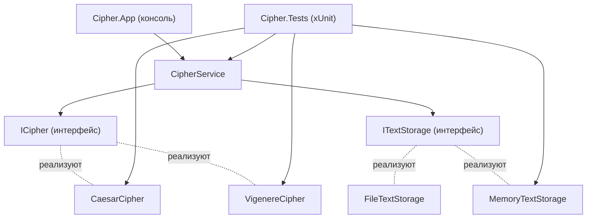

# БОНУС: Диаграмма зависимостей

- `Cipher.App` знает только про `CipherService` и конкретные классы
  в одном месте — при создании (пункт «сборка»).
- `CipherService` зависит только от интерфейсов: добавить новый шифр —
  написать класс и выбрать его при старте.
- `MemoryTextStorage` используется в тестах, `FileTextStorage` — в приложении.
